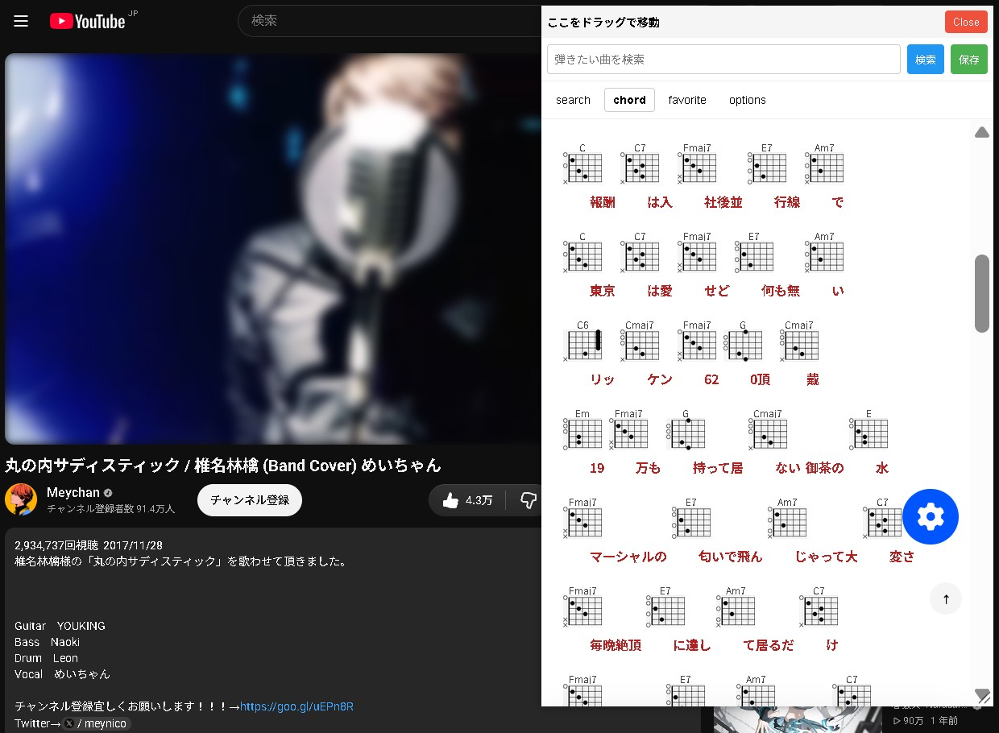

[日本語](README.ja.md)
# Overview
This userscript integrates U-Fret (ufret.jp) chord search and display features directly into YouTube.
This allows you to quickly check chord information while watching music videos.

# Features
1. **Save Button**
   - `scroll speed`, `chord key`, and `videoId` are saved in the favorite tab, and when the video URL and saved videoId match, they are automatically displayed with the saved settings in the chord tab.
2. **Options Tab**
   - `Always Hide:` The overlay will always be hidden.
   - `Import/Export:` You can share saved chords. (Saves songs that don't match the videoId.)
# Installation
1. **Install Tampermonkey**  
   - Chrome : [Tampermonkey](https://chromewebstore.google.com/detail/tampermonkey-%E3%83%99%E3%83%BC%E3%82%BF%E7%89%88/gcalenpjmijncebpfijmoaglllgpjagf)
   - Firefox : [Tampermonkey](https://addons.mozilla.org/ja/firefox/addon/tampermonkey/)

2. **Allow userscript**  
   Enable “Allow User Scripts” in the Extensions settings. For more details, see the official [FAQ](https://www.tampermonkey.net/faq.php?locale=en&q=Q209).

3. **Install youtube-ufret-chords-usersciprt**    
   You can install it [here](https://github.com/grmpnk/youtube-ufret-chords-usersciprt/raw/refs/heads/main/userscript.user.js)
